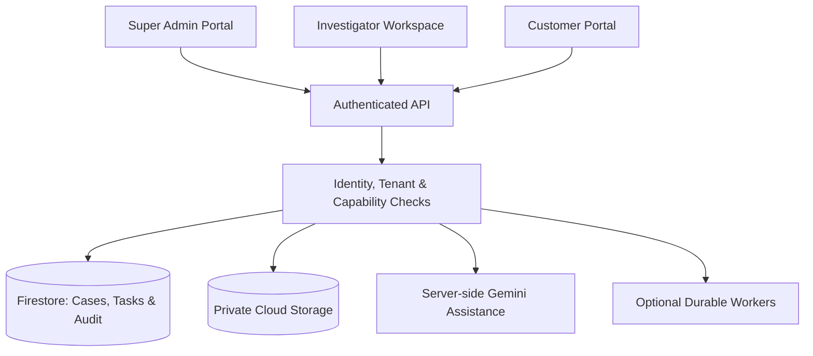

 RiskWeave AI

# Explainable, Human Centered Fraud Investigation & Case Management

> *Understand the alert. Check the evidence. Know what happens next*

RiskWeave AI is a **Google Gemini assisted investigation platform** designed around retail-bank onboarding and identity linkage alerts. It brings case review, evidence verification, customer information requests, team coordination, and human decision-making into one traceable workflow.

Rather than treating an AI risk assessment as a verdict, RiskWeave AI is designed to help an authorized investigator understand **why a case needs attention, which sources support the concern, what information is missing, and which policy-permitted action should come next**.

**Project status:**  -  Working model with Demoe cases . this works after notificatoon recives .

## The Problem

Investigation teams often work across disconnected alerts, evidence documents, review queues, and customer communications. This makes it difficult to reconstruct decisions, track unresolved verification tasks, avoid duplicate requests, and explain why an outcome was reached. AI-generated summaries can save review time, but they can also create risk when their claims are not linked to evidence or are mistaken for approved decisions.

## The RiskWeave Approach

- **Evidence before conclusions:** Important findings link back to their precise sources, versions and verification status.
- **Human-in-the-loop decisions:** Gemini assists with interpretation; authorized people review evidence, record decisions, and grant required approvals.
- **Clear next actions:** Each case identifies its current owner, blockers, outstanding tasks, and permissible next step.
- **Role-based privacy:** Staff and customers see different, strictly scoped information and actions.
- **Reproducible history:** Evidence changes, AI runs, assignments, customer responses, reviews, and decisions are recorded as distinct events.
- **Deterministic controls:** Permissions, task routing, deadlines, readiness gates, and approval requirements are enforced by application logic—not AI guesses.

## Main Capabilities (Design Scope)

### 1. Investigation Workspace

A list-first **Cases** experience organized by *My work*, *Team work* (where authorized), *Needs action*, *Waiting*, and *Closed*. Case views bring together:

- Alert context, ownership, workflow state, and due dates.
- A structured review: **What needs attention → What the evidence shows → What to check next → Your decision**.
- Source-linked findings, missing information, contradictions, and evidence comparisons.
- Case-level **Review**, **Tasks**, and **History** views.
- Version-aware changes since the investigator's last review.
- Decision drafts, explicit submission, and exportable historical review packets.

### 2. Explainable AI Assistance

Google Gemini is intended to provide bounded, source-grounded investigative assistance, including evidence interpretation, alternative explanations, uncertainty, and potential next checks. The design also preserves advanced review tools for:

- **Evidence sensitivity:** Explore how an assessment changes when particular evidence is removed.
- **Policy comparison:** Compare permitted outcomes under different policy versions using fixed evidence.
- **What-if analysis:** Explore hypothetical evidence without treating it as an actual submission.
- **Assessment comparison:** Evaluate rules-only, single-model, and bounded multi-role approaches on controlled inputs.

AI output is **advisory**. It does not authenticate uploaded documents, assign staff, authorize access, contact customers, approve proposals, or close cases on its own.

### 3. Three Connected User Experiences

| User | Primary responsibilities |
| --- | --- |
| **Super Admin** | Manage institution-scoped investigator accounts, configure assignment eligibility and capacity, assign work, supervise authorized cases, review quality results, and administer tightly scoped temporary cover. |
| **Investigator / Analyst** | Work on assigned cases, inspect evidence, review customer submissions, request additional information, document findings, use approved AI assistance, and propose permitted case actions. |
| **Customer** | Access only their own published requests and updates, securely provide documents or explanations, receive submission receipts, and respond to correction requests. |

Senior or supervisor permissions are **explicit capabilities**, not automatic privileges of every investigator. Customer views must never expose internal risk assessments, staff notes, hidden thresholds, or other customers' records.

### 4. Customer Request-to-Review Flow

RiskWeave AI's intended end-to-end flow connects an evidence gap to the eventual human outcome:

1. An authorized staff member identifies a missing or contradictory item.
2. A reviewed request is deliberately published to the appropriate customer's authenticated portal.
3. The customer uploads information, saves a draft, or requests clarification.
4. Intake checks produce an accurate processing state and receipt.
5. An authorized investigator **accepts an item for use**, requests a correction, or starts additional verification.
6. Relevant evidence is versioned and dependent assessments are refreshed when necessary.
7. A human reviewer records a policy-permitted decision, with further approval when required.
8. Only a separately authorized, customer safe status update is published.

**Important:** Accepting a document *for use* is not the same as verifying its factual claims or approving a customer's application.

### 5. Assignment, Availability & Temporary Cover

- Manual assignment and an explainable, capacity aware auto assignment flow are designed for **actual Super Admin** authority.
- Automatic routing uses eligibility, availability, workload/capacity, skills, and conflict checks—not Gemini-generated suitability scores.
- Each staff member controls **only their own declared availability**. An administrator can manage routing eligibility and capacity, but cannot impersonate someone's availability declaration.
- Temporary cover can grant a named investigator **specific operational actions for specific cases/queues and a limited period**.
- Delegation cannot grant the Super Admin role, investigator administration, unrestricted settings, or auto-assignment control.
- Delegated actions retain the real actor's identity and can be reviewed after the administrator returns.

### 6. Critical Decisions & Independent Approval

Critical case dispositions and internal recommendations to reject an application are designed to require **a proposal author plus two separate, eligible human approvers**. The system must block self-approval, duplicate votes, stale evidence, expired delegation, and attempts to bypass non-overridable policy checks.

The product distinguishes:

- **Request correction:** A customer-submitted item is incomplete or unsuitable for a particular request.
- **Return / decline proposal:** A reviewer does not approve another staff member's proposed action.
- **Recommend application rejection:** A controlled *internal recommendation*, **not** an executed banking-system rejection.

The original internal assessment/action vocabulary includes `CLEAR`, `REQUEST_MORE_EVIDENCE`, `ENHANCED_VERIFICATION`, and `ESCALATE`.

### 7. Notifications, Auditability & Quality Checks

- One in-app **Inbox** for actionable updates, assignments, responses, approvals, and reminders.
- Persistent case tasks and notifications with explicit read/completion states.
- An attributed, append-oriented history of source revisions, evidence findings, AI assessments, assignments, decisions, and delegated actions.
- **Case readiness:** Deterministic checks for evidence, verification, unresolved contradictions, current assessments, and required approvals.
- **System checks:** Tests of the configured backend and supporting services.
- **AI evaluation:** Versioned comparisons with declared datasets, run modes, denominators, failures, and limitations—without fabricated accuracy claims.

A notification being read does **not** mean its underlying task is complete. A successful system health check does **not** establish AI accuracy or case correctness.

## Typical Case Lifecycle

```text
New
  → In Review
  → Waiting for Information / Additional Verification / Awaiting Specialist
  → In Review (with updated evidence)
  → Supervisor Review (when required)
  → Closed (after policy gates and required human approvals)
```

The workflow is not always linear: outstanding tasks can span multiple reviews, material evidence changes can make previous assessments stale, and authorized reopening preserves the earlier decision history.

## Technology & Architecture

The specifications describe a **Google-hosted architecture** and require reuse of the project's existing working components rather than a rewrite. The intended technology areas are:

| Layer | Specified technology / responsibility |
| --- | --- |
| Web interface | Existing **React, TypeScript, and Vite** frontend, subject to repository verification |
| Server API | Existing **Node.js / Express** backend, subject to repository verification |
| Generative AI | **Google Gemini** through server-side Google SDK/configuration |
| Authentication | **Firebase Authentication**, supplemented with current server-enforced memberships and permissions |
| Application data | **Cloud Firestore** for scoped cases, tasks, grants, decisions, reviews, and audit records |
| Documents | **Private Google Cloud Storage** for controlled uploads and authorized retrieval |
| Hosting & secrets | **Cloud Run** and **Secret Manager**, where configured |
| Background processing | **Cloud Tasks / Cloud Scheduler** only where actually deployed and verified |



This is a **target architecture diagram**, not proof that every service is deployed.

## Security & Responsible AI

RiskWeave AI is designed around deny-by-default authorization, strict tenant separation, assignment/ownership checks, field-level mutation allowlists, revocable access, and server-side checks on every sensitive API and file operation. Other safeguards in scope include immutable historical references, explicit evidence verification, bounded AI runs, version checks that prevent stale approval, restricted customer-safe responses, and isolated synthetic demo data.

The project is a **research/prototype investigation workflow**. It is **not** a production banking decision engine and does not itself freeze accounts, execute real application rejection, or submit regulatory reports. No claim of regulatory certification, real-world fraud reduction, or measured model accuracy is made without supporting test evidence.

## Getting Started

The supplied materials specify the platform's desired behavior but **do not provide a verified application repository, package scripts, environment-variable names, or live deployment configuration**. The exact installation commands must therefore be taken from the project's actual source rather than guessed here.

To prepare a development environment:

1. Inspect the repository's frontend/backend package manifests and existing start scripts.
2. Configure the actual Google/Firebase project and authentication for separate, non-shared test users.
3. Provide server-side Gemini access and secrets through the project's documented configuration; **never commit credentials**.
4. Apply the repository's verified Firestore security rules, indexes, Cloud Storage access controls, and additive migrations.
5. Use isolated **synthetic** cases and customer documents for local/demo testing.
6. Run the repository's real build, integration, access-control, and end-to-end tests, and record their results.

Add concrete `git clone`, install, run, and deployment commands here **after verifying the actual codebase**.

## Verification & Roadmap

The specification's high-priority acceptance areas are:

- [ ] Verify that ordinary investigators cannot access administrator APIs or change another person's availability.
- [ ] Verify institution- and case-scoped access for all three roles, including direct API and storage requests.
- [ ] Verify manual and admin-only auto-assignment, including concurrency/capacity safeguards.
- [ ] Verify temporary-cover scope, expiry, revocation, attribution, and return-to-work history.
- [ ] Verify two independent approvals for critical proposals and correct handling of stale versions.
- [ ] Verify case readiness, system health checks, and reproducible AI evaluation runs.
- [ ] Verify the complete **Admin → Investigator → Customer → Investigator → Approval** journey.
- [ ] Publish current setup instructions, feature status, real test results, and known limitations.

*These are **verification checkpoints**, not a statement that each feature is absent. Mark items complete only with evidence from the repository and executed tests.*

## Project Philosophy

**AI should make investigations easier to understand—not harder to question.** RiskWeave AI combines clear workflows, evidence provenance, accountable human review, and narrowly defined automation so that teams can answer the important questions: *What happened? Why does it matter? What is still missing? Who is responsible? What was actually decided?*

---

**RiskWeave AI** · *Understand the alert. Check the evidence. Know what happens next.*
